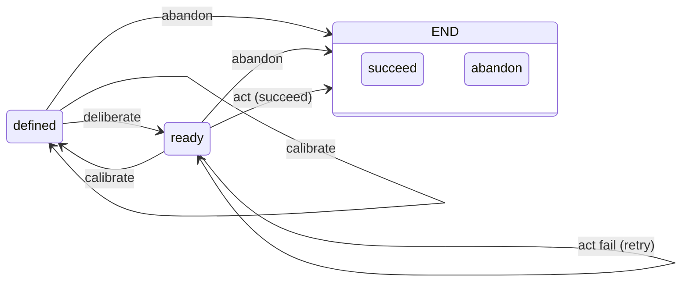

# Elan Agentic Concept

## Overview

Elan is the agentic layer of the orchestration platform. It composes `ash` (scripting) and `dust` (directory orchestration) as execution primitives to drive underlying agents through the `agent-adapter`.

This document captures the current (rough) concept for elan's agentic behavior. It will be refined iteratively.

## 1. Goals

An **elan agent** takes a **goal** as input and pursues that goal relentlessly.

- A goal is the atomic unit of elan's work. Everything elan does is in service of a goal.
- The agent does not stop at "one shot" — it keeps working the goal until the goal reaches a terminal state.
- Goals form a tree: a parent goal is pursued by decomposing it into sub-goals.

*Related work:* relentless, goal-driven pursuit is the defining behavior of autonomous agent loops (BabyAGI task lists, AutoGPT) and of interleaved reason-and-act systems like ReAct (Yao et al., 2023). See the [survey in `steering-concept.md`][steering-poc].

## 2. Goal FSM

A goal's lifecycle is modeled by a basic finite-state machine (FSM):



- **States** (status): `defined`, `ready`, `end`
  - `end` is terminal, with an outcome of `succeed` or `abandon`. *There is no `failed` outcome — failing an `act` means the goal is abandoned.*
- **Actions** (transitions):
  - **`deliberate`** — refine/design/decompose the goal; the key action, see [§3 Deliberate](#3-deliberate--the-key-action).
  - **`act`** (a.k.a. implement/execute) — drive the actual work through `ash`/`dust`.
  - **`calibrate`** — parent goal-agent monitors child execution and decides to **redefine** (→ `defined`) or **abandon**; applicable in both `defined` and `ready`. See [§4 Calibrate](#4-calibrate--parent-agent-monitoring).
  - **`abandon`** — stop pursuing the goal and mark it `end(abandon)`.

*Related work:* goal lifecycles as explicit state machines descend from classical goal stacks and from hierarchical task networks, where a task carries its own completion/termination conditions (Erol, Hendler & Nau, 1994; Sutton, Precup & Singh, 1999). See the [survey in `steering-concept.md`][steering-poc].

### No "executing" state

We deliberately do **not** model *executing* as a state. The very existence of a goal (once `ready`) means the elan agent is relentlessly acting to pursue it — relentless action is the default condition, not a distinct phase. There is nothing to model: a goal does not "enter executing"; it simply is, and the agent keeps acting on it until it reaches `end`.

What the FSM does need is an **`act` action** — `act`/`implement`/`execute` — to abstract the concrete execution step: delegating to `ash`/`dust` which in turn drives the underlying agent (via `agent-adapter`). `act` is how a goal's pursuit becomes real work, but the goal's *status* never reflects it; status is only ever `defined`, `ready`, or `end`.

*This is a rough initial model; the exact state/action set will be refined.*

## 3. Deliberate — the key action

`deliberate` is where the interesting agentic behavior happens. It can include steps such as:

- **refine** — sharpen the goal's definition
- **design** — design an approach / solution
- **decompose** — split the goal into sub-goals

By applying **recursive decomposition** (deliberate → decompose → sub-goals → deliberate each sub-goal, …), elan establishes an **orchestrator**: a goal tree that drives all downstream execution through `ash`/`dust`.

`deliberate` is complemented by **`act`** — the concrete execution of the goal through `ash`/`dust` by the underlying agent. `deliberate` decides *what* to do; `act` does it.

*Related work:* hierarchical decomposition is classical HTN planning (Erol, Hendler & Nau, 1994; SHOP2: Nau et al., 2003). Decomposition *as-needed* — deliberate one level at a time, defer the rest — is the finding of ADaPT (Prasad et al., 2024). See the [survey in `steering-concept.md`][steering-poc].

## 4. Calibrate — parent-agent monitoring

`calibrate` is modeled on how a human expert actually works on a goal: not a plan-then-execute sequence, but a **continuous re-assessment of the current context with adjustment along the way**. The assessment is **not a pre-execution step** — it is *part of* execution.

- **The parent goal-agent monitors its child goal's execution** and decides whether calibration is needed.
- **Calibration outcome is `redefine` or `abandon`.** If the parent redefines, the child returns to `defined` and adjusts accordingly. If the parent abandons, the child goes to `end(abandon)`.
- **Sibling re-evaluation is a parent's assessment.** When the parent recalibrates, it re-assesses its own sub-goals — the siblings of the current active sub-goal. This does **not** necessarily affect all of them; the parent decides which, if any, are impacted.
- **Calibration cascades up and down.** *Upward:* the parent itself reports to *its* parent, so a recalibration may propagate further up the tree. *Downward:* a redefined child may in turn redefine its own children (grandchildren of the original), which can involve change rollbacks — **rollback handling is deferred, to be addressed later**.
- **Monitoring is done via regular progress reporting**: each sub-goal agent reports progress back to its parent periodically — the same way human organizations work. The parent steers/calibrates based on those reports, not on inspection of the child's internals.

### No self-challenging (why legitimacy feedback was removed)

The original concept paper (`steering-concept.md`) included a **legitimacy challenge**: a sub-goal questioning its own premise and issuing feedback upward. We **deliberately removed self-challenging**:

- **To avoid oscillation.** If a sub-goal can challenge its own legitimacy, it risks repeatedly questioning its own premise — oscillating between pursue and question instead of making progress.
- **The feedback interface to the parent is now progress reporting only.** A child reports state/outcomes; it does not challenge. **Steering/calibrating is the parent's responsibility** — the parent decides whether the child's goal should be redefined or abandoned, based on those reports.

This is the upward/downward loop: children report up; parents steer and calibrate down.

*Related work:* adjusting the goal (not just the method) is double-loop learning (Argyris & Schön, 1974/1978/1996); detecting that a goal needs revision is goal-driven autonomy (GDA); re-assessment *during* execution rather than before it is the reflective practitioner (Schön, 1983) and plans-as-resources (Suchman, 1987). Progress-report-driven parent monitoring mirrors management-by-objectives (Drucker, 1954) and Simon's nearly decomposable hierarchies (Simon, 1962). See the [survey in `steering-concept.md`][steering-poc].

## 5. Human steering

The human operates at the **judgment** layer: a source of domain knowledge and taste that prunes the search space — not an approval gate over routine actions. The human engages at **structured decision points** and **bounded times**, never continuously.

- **Interaction points (what to surface):**
  - **Priority setting / re-ordering** — setting and re-ordering top-level goal priorities.
  - **Calibration decisions** — when a parent's assessment is ambiguous, the parent presents the evidence and the human decides (redefine vs abandon).
  - **Search direction** — when a goal has multiple plausible decompositions, the human steers the direction.
- **Timing (when to engage):** human input is requested only at these high-leverage points. The agent does not pause for routine steps — relentless action is the default (see [§2, no "executing" state](#2-goal-fsm)). The agent argues; the human decides.
- **Mechanism (how it's delivered):** judgment is injected through an elan surface (`elan-vscode` steering/decision GUI, or the `elan` CLI) and written to the goal's filesystem state (e.g. a decision note in the goal folder), so agents and subsequent steps act on it. *(Exact mechanism to be refined.)*

*Reasoning:* the full what/how/when design rationale, triggers, waiting semantics, and failure modes are worked through in [Human Steering: What, How, When][human-steering].

## 6. Filesystem-backed goal state

The application models **only** the fundamental status of a goal (the FSM above). All actual goal state data lives on disk as files inside a goal folder:

```
goal-folder/
├── goal.md            # mandatory — the goal specification
├── state              # state file — indicates/persists the current status
├── design-01.md       # supporting design docs (unlimited)
├── data.csv           # supporting data files (unlimited)
└── ...
```

- `goal.md` is **mandatory**.
- A **state file** records and persists the goal's current FSM status.
- Supporting design docs, data files, and anything else are unlimited and unconstrained.
- **Agentic steps operate on these files directly and independently.** The application does not manage any goal state data other than the state file.

This keeps the application tiny and the goal fully inspectable/portable: the goal's entire world is a folder on disk.

*Related work:* file-centric task management, folder-as-state patterns, and the git working tree as source of truth are common in coding-agent tooling; the goal folder is a document-backed, human-auditable state store.

## 7. Goal hierarchy via folder structure

Because goal state is files in a folder, the **folder structure itself represents the goal hierarchy**:

```
goals/
└── 01-fix-login/
    ├── goal.md
    ├── state
    └── 01-redesign-auth/
        ├── goal.md
        └── state
```

- **Sub-folders are sub-goals.**
- Folders/files starting with `.` are **excluded** — sub-folders whose name starts with `.` are *not* sub-goals. This avoids conflicting with the many dot-tools that also live in folders (`.git`, `.github`, `.vscode`, …).

*Related work:* hierarchical composition of this kind is Simon's "architecture of complexity" — nearly decomposable hierarchies of semi-independent units (Simon, 1962), the same structure HTN planning uses. See the [survey in `steering-concept.md`][steering-poc].

## 8. Rolling decomposition

Decomposition follows the **rolling decomposition** principle:

- Only **one layer** is decomposed at a time.
- Further decomposition happens only when we (agent or human user) **start actively working on that goal**.
- The `deliberate` action is applied **only to the current active goal**.
- **Sibling goals wait** — a sub-goal is worked only after the prior sibling goal has finished.
- Parallel execution of goals may be introduced later.

This means the goal tree is built lazily and stays shallow until a goal is actually pursued — no upfront full decomposition.

*Related work:* one-layer-at-a-time, on-demand decomposition is precisely ADaPT's empirical result — as-needed decomposition outperforms full pre-decomposition (Prasad et al., 2024). Plans-as-commitments-under-limited-information (Simon, 1947) and skill as evolving process (Dreyfus & Dreyfus, 1986) motivate keeping the tree shallow until worked. See the [survey in `steering-concept.md`][steering-poc].

[steering-poc]: ./philosophy/steering-concept.md
[human-steering]: ./philosophy/human-steering.md
