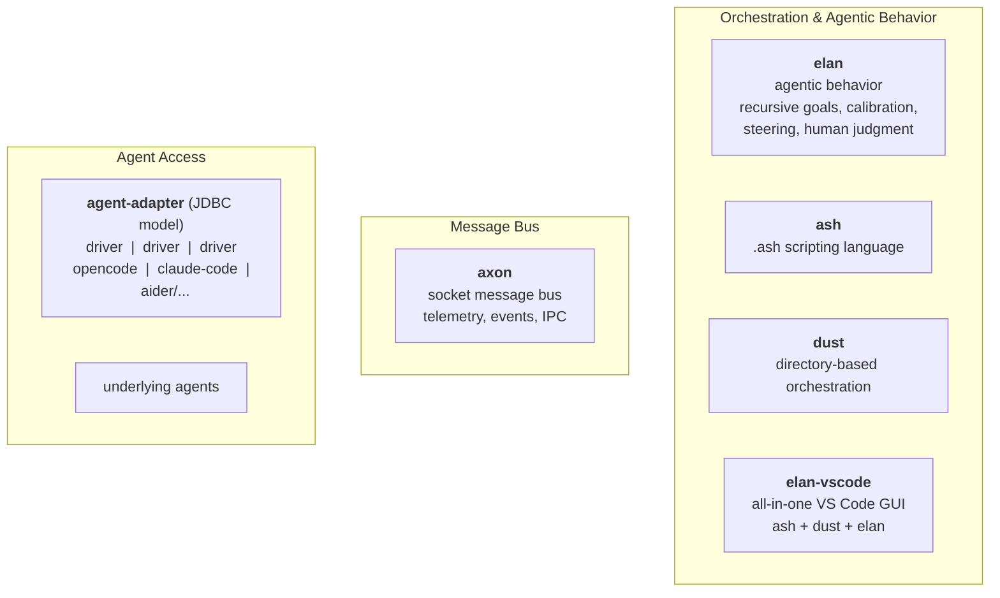
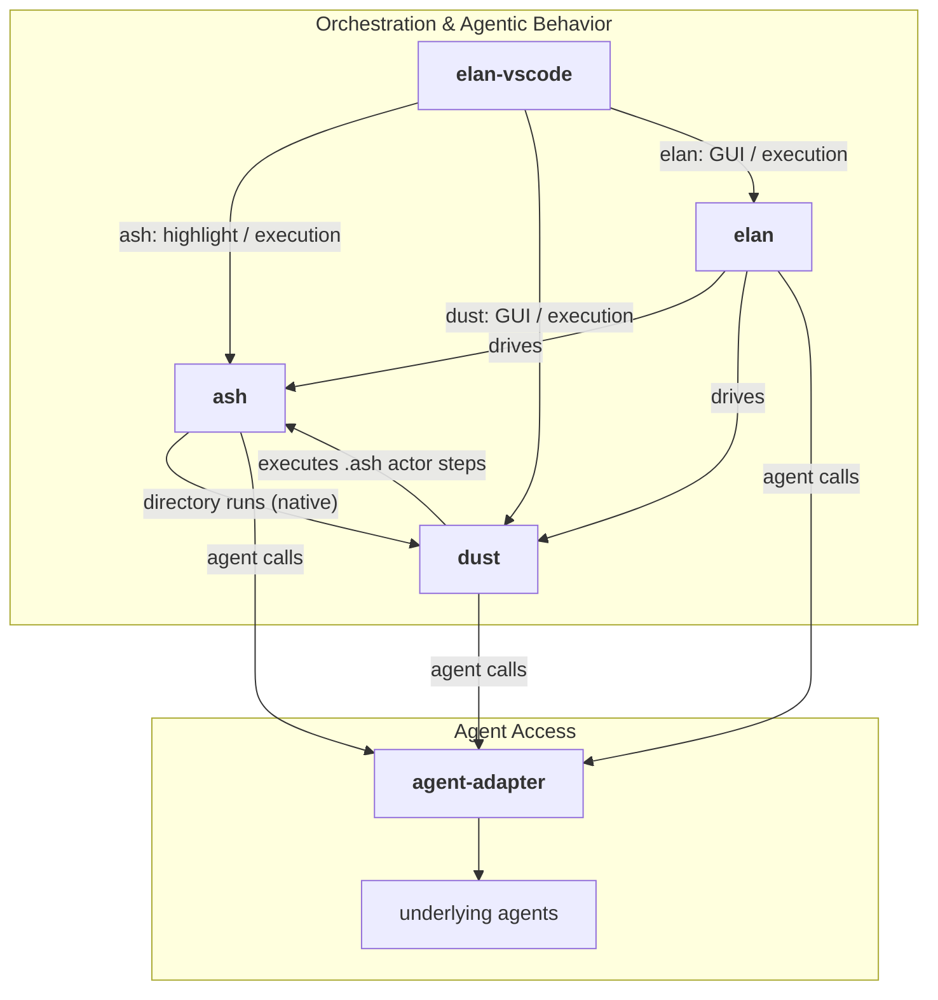
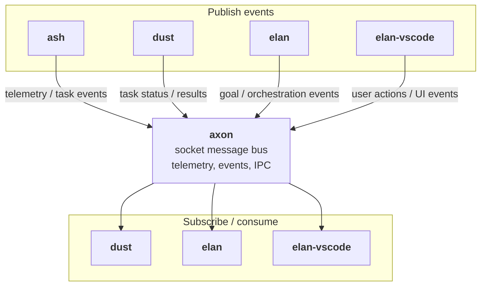

# Vision — Agent Orchestration Platform Reorganization

## Purpose

This document captures the vision for reorganizing the agent orchestration applications under `old_code/` into a set of small, independently-evolving components with clean boundaries. The goal is to untangle responsibilities that have accreted over time so that each component owns one concern and can be developed, tested, released, and adopted on its own.

## Current State and Problems

The components today grew organically. Each now mixes several concerns:

| Component | Origin | What it has become |
|-----------|--------|--------------------|
| `ash` | A scripting language (`.ash`) whose purpose was to let `.ash` scripts natively support agent operations | A monolith that also contains **directory-based task orchestration**, **telemetry**, a **daemon + message channel** (`ashd`), a **VS Code language extension** (`ash-vscode`), a **WASM build**, a **studio web UI**, and direct **agent drivers** |
| `dust` | A VS Code extension applying an "actor" over a selected file/folder (directory-based orchestration inside VS Code) | Tightly couples **directory-based orchestration logic** with the **VS Code GUI** (`extension`, `webview`), plus its own **telemetry** and **callback plumbing** |
| `ashco` | An orchestration controller | Overlaps with `ash`/`dust` orchestration concerns |
| `steering-poc` | A concept paper on recursive goal decomposition with upward legitimacy feedback | The conceptual seed for `elan`'s agentic behavior |

### Core problems

1. **`ash` is a monolith.** The `.ash` scripting language, directory execution, telemetry, message channel, and agent drivers are all coupled in one binary. They have different lifecycles and consumers, but cannot evolve independently.
2. **`dust` mixes orchestration with GUI.** Directory orchestration logic is inseparable from the VS Code extension host, so the core is unusable outside VS Code and hard to test.
3. **No shared messaging backbone.** `ashd` carries a message channel and telemetry over local pipes — tightly bound to `ash`, not reusable by `dust`, `elan`, or third parties.
4. **No unified agent abstraction.** Every component talks to underlying agents (opencode, claude-code, aider, …) directly. Agent drivers are duplicated and scattered.
5. **Orchestration and agentic behavior are conflated.** Deterministic orchestration (run these files in order) and *agentic* behavior (recursive goal decomposition, legitimacy feedback, steering) live in the same code paths, blurring the boundary.

## Target Architecture

The reorganization produces **five** components, each owning exactly one concern:

### Interaction overview

Components interact along **two independent dimensions**, shown separately below to keep each diagram simple:

| Dimension | Mechanism | Typical use |
|-----------|-----------|-------------|
| **Direct invoke** | Synchronous method/library call (`drives`, `delegates to`) | Explicit, ordered control flow — a component calls another to get work done now |
| **Event / bus** | Asynchronous publish-subscribe over `axon` | Telemetry, notifications, status changes, coordination between otherwise-decoupled components |

#### Direct method / command invocation

#### Event / bus interaction

The direct-invoke edges are synchronous, ordered, and explicit. The bus edges are asynchronous, decoupled, and triggered by events — producers publish, interested consumers subscribe, and neither needs to know about the other.

### Core-as-library principle

Every component follows the same shape: its **core logic is a library with no user surface**; the user surface (CLI, VS Code extension, web app, …) is a thin layer over that library, separated by a clear boundary.

- **Core = library.** The engine, logic, and state live in a library that exposes a clean API. It knows nothing about how a human invokes it — no argument parsing, no UI, no editor integration.
- **Surface = thin shell.** A CLI, VS Code extension, or any other front-end consumes the library. It only translates user intent into library calls and renders results back.
- **Explicit boundary.** The library API is the contract; surfaces cannot reach into internals, and the core never acquires surface concerns. A surface can be a dedicated app/project that imports the library, or a command in the same repo — but the boundary stays intact.
- **Why.** Each core is testable headlessly, embeddable by any consumer (including other components and third parties), and each surface can evolve, be replaced, or be added (e.g. a new CLI or GUI) without touching the core.

So `ash`, `dust`, `axon`, and `elan` each ship a core library, with `elan-vscode` being exactly the kind of dedicated surface app this principle describes (a VS Code project that imports the `ash`, `dust`, and `elan` core libraries).

### Component ownership

| # | Component | Single responsibility | Out of scope |
|---|-----------|----------------------|--------------|
| 1 | `ash` | The `.ash` scripting language — parse, evaluate, run scripts with native agent operations (`do`, `session`, `evaluate`, …) **and native dust directory orchestration** | Directory walker implementation, telemetry, message bus, GUI, agent drivers |
| 2 | `dust` | Directory-based orchestration — walk a numbered task tree, execute `.md` task files in order, parallel groups, frontmatter, **with `.ash` scripts as actor steps** | VS Code GUI, telemetry, agent drivers |
| 3 | `elan-vscode` | The all-in-one VS Code extension GUI — ash script syntax highlight & execution, dust GUI & execution, elan GUI & execution — driving `ash`/`dust`/`elan` as libraries | Orchestration logic, scripting engine, agent drivers |
| 4 | `axon` | Socket-based message bus — events, telemetry, and IPC between all components | Orchestration, scripting, agents |
| 5 | `elan` | Agentic behavior — recursive goal decomposition, parent-driven calibration (redefine/abandon), human steering, composing `ash` and `dust` to drive underlying agents | Scripting language, directory walker, GUI, direct agent calls |

Plus one cross-cutting layer:

| Layer | Responsibility |
|-------|----------------|
| `agent-adapter` | A driver-based abstraction over underlying agents, modeled on **JDBC** — a standard protocol/interface with pluggable drivers per agent. No component talks to an agent directly; all go through this layer. |

## Component Details

### 1. `ash` — .ash scripting language

- Keep the language: parser, evaluator, control flow, `do`/`session`/`evaluate` statements, variables, functions, REPL, `--check`.
- **Remove:** directory task-tree walker (moves to `dust`), telemetry pipeline (moves to `axon`), `ashd` daemon/message channel (moves to `axon`), agent drivers (moves to `agent-adapter`).
- Consumes agents **only** through `agent-adapter`.
- **Native dust support:** ash scripts can run dust directory-based orchestration as a first-class operation — `do @"tasks/"` (or an equivalent native directive) hands off to `dust`'s tree walker in-process, sharing the same evaluator scope and variables. This is a native integration, not an external subprocess.

### 2. `dust` — directory-based orchestration

- Owns the numbered task-tree walker: discovery, sorting, parallel groups, frontmatter, task execution, `--dry-run`, `--continue-on-error`.
- **`.ash` scripts as actor steps (enhancement):** an actor is a definition of ordered steps (currently `.md` files only) applied over a selected file/folder. Dust gains native support for `.ash` files as actor steps — an `.ash` step is executed by the ash engine with the full language (variables, control flow, `do`), sharing the evaluator scope across steps of the same actor. This is distinct from the **target** directory being orchestrated: the target stays data (`.md`/files), while the actor defines the process, which may now be scripted.
- Native integration point for `ash`: when a script invokes dust directory orchestration, the walker runs in-process and reports step results back into the script's scope.
- Extracted as a reusable library (works headless, e.g. CLI) with a clean API.
- Consumes agents **only** through `agent-adapter`.
- **Remove:** VS Code extension/webview coupling (moves to `elan-vscode`), telemetry (moves to `axon`).

### 3. `elan-vscode` — all-in-one VS Code extension

- The single VS Code extension GUI covering all three runtimes:
  1. **ash** — `.ash` script syntax highlighting and script execution from VS Code.
  2. **dust** — GUI and execution for directory-based orchestration (tree view, task runs, actor selection, status surfaces).
  3. **elan** — GUI and execution for agentic workflows (goal tree, steering, calibration decisions).
- Thin shell — delegates to `ash`/`dust`/`elan` (as libraries) and all agent calls to `agent-adapter`.
- No dedicated `dust`-only extension; today's `dust` extension pieces (`adapters/vscode*`, `surface`, `webview`, `completion`) fold into this all-in-one extension.

### 4. `axon` — socket message bus

- A **socket-based** message bus (plain TCP — not pipes), replacing the current pipe-based channel in `ashd`.
- Carries: telemetry/events from `ash` and `dust`, orchestration events from `dust`/`elan`, and generic IPC between components.
- **MVP scope:** local binding only, **no auth/security** for now. Auth, TLS, and remote access are future work.
- Topic/routing model, publish-subscribe semantics, and durable telemetry store.
- Fully independent — no dependency on `ash`, `dust`, or `elan`.

### 5. `elan` — agentic behavior

- The agentic layer. Composition of goals, decomposition, execution, and reflection.
- Uses `ash` (for scripting-driven steps) and `dust` (for directory-driven steps) as execution primitives.
- Conceptually seeded by `steering-poc` (recursive goal decomposition, one layer at a time, upward legitimacy feedback, human-as-judgment). Self-challenging was dropped in favor of parent-driven calibration — see *Elan's agentic concept*. **The full agentic concept is to be specified separately** — see *Elan's agentic concept* below.
- Consumes agents **only** through `agent-adapter`.
- Runs over `axon` for telemetry and coordination.

## The Agent Adapter Layer (JDBC model)

Just as JDBC gives Java a uniform interface over databases with pluggable drivers, `agent-adapter` gives every component a uniform interface over agents with pluggable drivers.

- A small, stable **protocol/interface**: submit prompt, stream response, session continuity, abort, structured results.
- **Drivers** implement the interface for each underlying agent: `opencode`, `claude-code`, `aider`, and any public/future agent.
- Drivers register/auto-discover (like `ash discover` today) and can be loaded at runtime.
- **Invariant:** `ash`, `elan`, and `dust` contain **zero direct interaction** with underlying agents — all calls flow through `agent-adapter`.
- This is what lets `elan` drive "publicly available agents" interchangeably without code changes in the orchestration layers.

## Elan's Agentic Concept

Elan's agentic behavior is captured in a dedicated document: **[`concept.md`](./concept.md)**.

High-level direction, seeded by `steering-concept.md` (the copied source concept paper):

- **Goals** — an elan agent takes a goal as input and pursues it relentlessly.
- **Goal FSM** — minimal lifecycle: `defined` → `ready` → `end` (`succeed` | `abandon`; *no `failed`* — failing an `act` means abandon, with a `ready → ready` retry), with actions `deliberate`, `act`, `calibrate`, `abandon`. No *executing* state — a `ready` goal means relentless action by default; `act` abstracts the actual `ash`/`dust` execution by the underlying agent.
- **Deliberate** — the key action (refine / design / decompose); recursive decomposition builds the orchestrator.
- **Filesystem-backed state** — the app models only the status FSM; a goal's real state lives as files in a folder (`goal.md` mandatory, a state file, plus unlimited supporting docs/data). Agentic steps operate on the files directly.
- **Hierarchy via folders** — sub-folders are sub-goals; dot-prefixed names are excluded.
- **Rolling decomposition** — one layer at a time; decompose only when actively working the goal; siblings wait (parallelism later).
- **Progress reporting, not self-challenging** — children report progress to their parent only; self-challenging was removed to avoid oscillation, and calibration (redefine/abandon, with up/down cascades) is the parent's responsibility.
- **Human as judgment, not gate** — bounded human steering at structured decision points (priorities, calibration decisions, search direction).

## Non-Goals

- No component (other than `agent-adapter`'s drivers) will embed agent-specific logic.
- No component will embed another component's core concern (e.g. `dust` will not gain a scripting engine; `ash` will not regain the walker).
- `axon` MVP ships with no auth/security — remote/secure operation is explicitly deferred.
- This is a *reorganization*, not a rewrite: behavior and semantics should be preserved as logic moves across component boundaries.

## Evolution Path

1. **Define `agent-adapter` interface** — the foundation everything else relies on.
2. **Extract `dust` core** from the VS Code extension; today's `dust` GUI moves into the future `elan-vscode` shell.
3. **Add `.ash` steps to `dust`** — native `.ash` support in the tree walk, sharing the evaluator scope.
4. **Add native dust support to `ash`** — scripts invoke dust directory orchestration in-process.
5. **Strip `ash`** to the language; hand the walker to `dust`, telemetry/channel to `axon`.
6. **Stand up `axon`** (socket, local, no auth) and migrate telemetry/events off pipes.
7. **Introduce `elan`** and grow the agentic layer on top of `ash` + `dust` + `agent-adapter`.
8. **Build `elan-vscode`** as the all-in-one extension covering ash, dust, and elan surfaces.
9. **Refine elan's agentic concept** — iterate on `concept.md` and implement the goal FSM / filesystem-backed state.

Each step keeps the system working; components are extracted, not rewritten.

## Success Criteria

- A developer can use `ash` for scripting, `dust` for directory runs, `elan` for agentic workflows, and `elan-vscode` for all of it from the editor — without cross-component feature leakage.
- Adding a new agent requires writing one `agent-adapter` driver and nothing else.
- `ash`, `dust`, and `elan-vscode` have no direct agent knowledge; `axon` is usable by unrelated projects.
